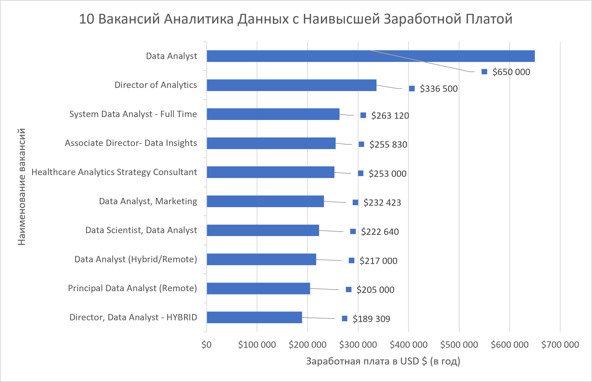
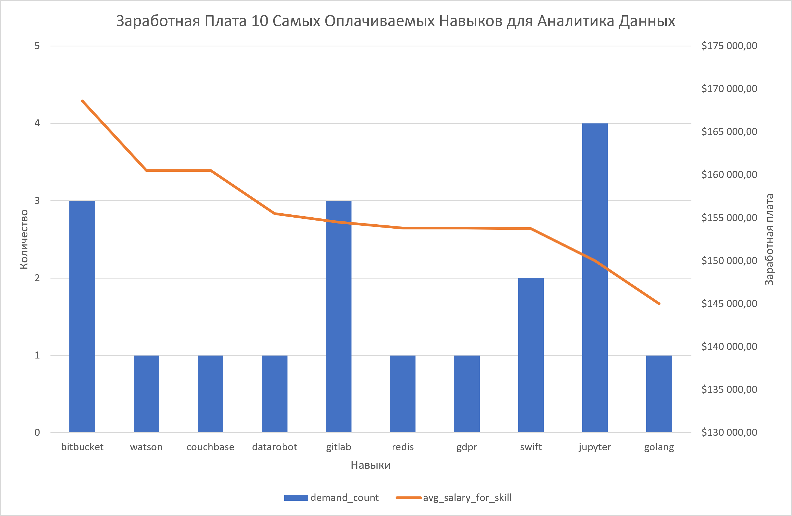

# Введение
В этом проекте исследуется рынок вакансий аналитиков данных. Основной фокус на трёх вопросах:
- Самая высокая заработная плата;
- Самые востребованные навыки;
- Пересечение востребованных навыков и высокой заработной платы.

В разделе [Основной Анализ](#основной-анализ) даны ответы на все 5 [вопросов](#вопросы) для вакансии "Аналитик данных" (Data Analyst) на удаленной работе. SQL-запросы приведены в соответствующих разделах с ответами на вопросы и продублированы в папках [Query_1](Query_1), [Query_2](Query_2) и т.д.

[Дополнительная Работа](#дополнительная-работа) также содержит ответы на вопросы по другим вакансиям и странам. Прежде всего этот раздел предназначен для тренировки навыков SQL, Excel и анализа полученных результатов. Все SQL-запросы можно будет найти в папке [Additional_work](Additional_work)

Источник данных [Hugging Face/Luke Barousse](https://huggingface.co/datasets/lukebarousse/data_jobs).

# Вопросы

1. Какая наивысшая заработная плата у аналитиков данных, работающих удалённо?
2. Какие навыки необходимы для работы аналитиком данных удалённо, чтобы получать наибольшую заработную плату?
3. Какие навыки являются самыми востребованными у аналитика данных удалённо?
4. Какие навыки для аналитика данных, работающего удалённо, связаны с наибольшей заработной платой?
5. Какие навыки являются оптимальными для аналитика данных на удалённой работе?

# Инструменты

- MySQL - база данных
- Visual Studio Code - инструмент для программирования
- Excel - визуализация данных

# Основной Анализ

### 1. 10 самых высокооплачиваемых вакансий среди аналитиков данных

Для получения ответа на этот вопрос выведем столбцы ID, наименование компании, полное наименование вакансии и заработную плату.
Отфильтруем данные, оставив только вакансии с названием 'Data Analyst', типом работы из дома и с указанной заработной платой. Отсортируем полученные данные по заработной плате по убыванию и оставим только 10 верхних значений.

Код SQL:

``` sql
SELECT 
    job_id,
    job_title,
    company_dim.name AS company_name,
    salary_year
FROM project
LEFT JOIN company_dim ON project.company_id = company_dim.company_id
WHERE job_title_short = 'Data Analyst' AND location LIKE 'Remote' AND salary_year IS NOT NULL
ORDER BY salary_year DESC
LIMIT 10;
```



*10 самых оплачиваемых вакансий среди аналитиков данных (сделано в Excel)*

Благодаря этому запросу мы можем выяснить, какие компании предлагают наивысшую зарплату по вакансии Data Analyst удалённо.

Выводы:
1) Заметен высокий разброс в заработной плате (от 189 тыс. до 650 тыс. долларов в год).
2) Разнообразие компаний, предлагающих вакансии: ИТ (Meta), здравоохранение (Mantys, Uclahealthcareers), анализ финансов (SmartAsset) и т.д.
3) Разнообразные наименования вакансий, отражающие разные роли и специализации среди аналитиков данных.

### 2. Необходимые навыки для 10 самых высокооплачиваемых вакансий аналитиков данных

Теперь к результату, полученному ранее, добавлю навыки, требуемые в этих вакансиях.

Код SQL:

```sql
WITH top_paying_jobs AS (
    SELECT
            job_id,
            job_title_short,
            salary_year
        FROM project
        WHERE job_title_short = 'Data Analyst' AND location LIKE 'Remote' AND salary_year IS NOT NULL
        ORDER BY salary_year DESC
        LIMIT 10
)
SELECT
    top_paying_jobs.job_id,
    top_paying_jobs.job_title_short,
    top_paying_jobs.salary_year,
    skills_dim.skills
FROM top_paying_jobs
INNER JOIN skills_job_dim ON top_paying_jobs.job_id = skills_job_dim.job_id
INNER JOIN skills_dim ON skills_job_dim.skill_id = skills_dim.skill_id;
```


*Частота упоминания навыков в 10 самых оплачиваемых вакансиях аналитиков данных (сделано в Excel)*

На графике указаны навыки, появляющиеся 2 и более раз.

Таблица со всеми навыками
|  skills  | count_skills |
|----------|--------------|
|sql       |   6          |
|python    |   5          |
|tableau   |   5          |
|flow      |   2          |
|r         |   2          |
|azure     |   2          |
|aws       |   2          |
|pandas    |   2          |
|excel     |   2          |
|power bi  |   2          |
|oracle    |   2          |
|snowflake |   2          |
|sheets    |   1          |
|databricks|   1          |
|pyspark   |   1          |
|jupyter   |   1          |
|powerpoint|   1          |
|hadoop    |   1          |
|crystal   |   1          |
|go        |   1          |
|numpy     |   1          |
|gitlab    |   1          |
|sap       |   1          |
|jenkins   |   1          |
|bitbucket |   1          |
|atlassian |   1          |
|jira      |   1          |
|confluence|   1          |

Выводы: самый популярный навык - SQL (встречается 6 раз). Второе и третье места делят Python и Tableau (по 5 раз). Остальные навыки встречаются реже - 1-2 раза, но всё ещё показывают спрос.


### 3. 10 самых популярных навыков для аналитика данных

Теперь выделим 10 самых популярных навыков, необходимых для аналитика данных.

Код SQL:

```sql
SELECT
    skills,
    COUNT(skills_job_dim.job_id) AS demand_count
FROM project
LEFT JOIN skills_job_dim ON project.job_id = skills_job_dim.job_id
LEFT JOIN skills_dim ON skills_job_dim.skill_id = skills_dim.skill_id
WHERE job_title_short = 'Data Analyst' AND location = 'Remote'
GROUP BY skills
ORDER BY demand_count DESC
LIMIT 10;
```


*10 самых популярных навыков для аналитика данных (сделано в Excel)*

Вывод: с большим отрывом лидирует SQL - ключевой инструмент для анализа данных. Следом идут Excel, Python и Tableau. Excel является базовым навыком для аналитиков данных, Python обладает обширной библиотекой для анализа данных, а Tableau используется для визуализации полученных результатов.


### 4. 10 самых высокооплачиваемых навыков аналитика данных

В прошлом вопросе удалось найти навыки, обладающие наивысшим спросом. Теперь необходимо узнать, какие навыки связаны с наивысшей заработной платой.

Код SQL:

```sql
SELECT
    skills,
    COUNT(skills_job_dim.job_id) AS demand_count,
    ROUND(AVG(project.salary_year), 0) AS avg_salary_for_skill
FROM skills_dim
LEFT JOIN skills_job_dim ON skills_dim.skill_id = skills_job_dim.skill_id
LEFT JOIN project ON skills_job_dim.job_id = project.job_id
WHERE job_title_short = 'Data Analyst' AND location = 'Remote' AND project.salary_year IS NOT NULL
GROUP BY skills
ORDER BY avg_salary_for_skill DESC
LIMIT 10;
```



*10 самых оплачиваемых навыков для аналитика данных (сделано в Excel)*

Вывод: навыки относятся ко многим областям (большие данные, библиотеки Python, облачные технологии, инструменты машинного обучения и т.д.). Но при этом спрос на подобные навыки достаточно низок. Эти навыки чаще встречаются у специалистов высокого уровня в анализе данных.


### 5. Оптимальные навыки для изучения на аналитика данных

Теперь необходимо определить оптимальный набор навыков для аналитика данных.

Код SQL:

```sql
WITH demand_skills AS (
    SELECT
        skills_dim.skill_id,
        skills_dim.skills,
        COUNT(skills_job_dim.job_id) AS demand_count
    FROM project
    INNER JOIN skills_job_dim ON project.job_id = skills_job_dim.job_id
    INNER JOIN skills_dim ON skills_job_dim.skill_id = skills_dim.skill_id
    WHERE job_title_short = 'Data Analyst' AND location = 'Remote' AND project.salary_year IS NOT NULL
    GROUP BY skills_dim.skill_id, skills_dim.skills
), average_salary AS (
    SELECT
        skills_dim.skill_id,
        skills_dim.skills,
        ROUND(AVG(project.salary_year), 0) AS avg_salary_for_skill
    FROM skills_dim
    INNER JOIN skills_job_dim ON skills_dim.skill_id = skills_job_dim.skill_id
    INNER JOIN project ON skills_job_dim.job_id = project.job_id
    WHERE job_title_short = 'Data Analyst' AND location = 'Remote' AND project.salary_year IS NOT NULL
    GROUP BY skills_dim.skill_id, skills_dim.skills
)

SELECT
    skills_dim.skill_id,
    skills_dim.skills,
    demand_count,
    avg_salary_for_skill
FROM skills_dim
INNER JOIN demand_skills ON skills_dim.skill_id = demand_skills.skill_id
INNER JOIN average_salary ON skills_dim.skill_id = average_salary.skill_id
WHERE demand_count >= 25
ORDER BY avg_salary_for_skill DESC, demand_count DESC
LIMIT 25;
```


*25 самых оптимальных навыков для аналитика данных (сделано в Excel)*

Таблица со всеми 25 навыками

|   skills   | demand_count | avg_salary_for_skill |
|------------|--------------|----------------------|
|hadoop      |   26         |    $113 449          |
|azure       |   53         |    $105 111          |
|java        |   32         |    $102 018          |
|snowflake   |   69         |    $100 841          |
|go          |   51         |    $99 309           |
|looker      |   65         |    $99 202           |
|oracle      |   68         |    $98 728           |
|aws         |   59         |    $98 165           |
|flow        |   54         |    $97 664           |
|sas         |   109        |    $96 734           |
|python      |   388        |    $95 764           |
|r           |   237        |    $95 279           |
|jira        |   33         |    $94 560           |
|sql         |   701        |    $93 048           |
|tableau     |   404        |    $92 892           |
|spark       |   28         |    $92 191           |
|power bi    |   196        |    $92 156           |
|sheets      |   55         |    $91 046           |
|qlik        |   26         |    $90 062           |
|sharepoint  |   34         |    $89 651           |
|sql server  |   63         |    $87 448           |
|sap         |   38         |    $87 181           |
|vba         |   41         |    $86 971           |
|powerpoint  |   91         |    $86 116           |


Выводы:
1) Языки программирования Python и R имеют достаточно высокий спрос (388 и 237 соответственно). Кроме того, эти навыки обладают ещё и высокой заработной платой ($95 764 и $95 279).
2) Azure, Snowflake и AWS - облачные технологии с достаточно высокими заработными платами ($105 111, $100 841 и $98 165) и значительным спросом (53, 69 и 59 соответственно).
3) Технологии для визуализации данных Tableau и Looker. Tableau показывает высокий спрос, но среднюю заработную плату (спрос 404, заработная плата $92 892). Looker, напротив, показывает средний спрос, но высокую заработную плату (спрос 65, заработная плата $99 202).
4) Среди технологий баз данных SQL показывает крайне высокий спрос и среднюю заработную плату (спрос 701, заработная плата $93 048). Oracle и SQL Server показывают средний спрос (спрос 68 и 63 соответственно), но заметно разную заработную плату ($98 728 и $87 448 соответственно).

# Итоги

По результатам анализа я сделал следующие выводы:
1) Аналитикам данных на удалённой работе предлагается достаточно широкий диапазон заработных плат. Самая высокая достигает 650 тыс. долларов.
2) SQL - один из самых востребованных навыков для аналитиков данных на любых уровнях: и на начальных, и на высоких.
3) Я узнал об узконаправленных навыках, которые связаны с более высокой заработной платой.
4) SQL является одним из ключевых навыков для изучения, так как повышает шансы на получение более высокой заработной платы.

Данный проект позволил мне улучшить свои навыки в работе с такими инструментами, как SQL, Python, Excel и VS Code. Также я лучше стал понимать, какие навыки необходимо изучать аналитику данных.      

# Дополнительная Работа

Больше практики с другими вводными для тренировки в использовании SQL и обучению анализу и подведении выводов из полученных результатов.

# English

## Intro


## Questions


## Tools


## Main Analysis


## Conclusion


## Additional Work
