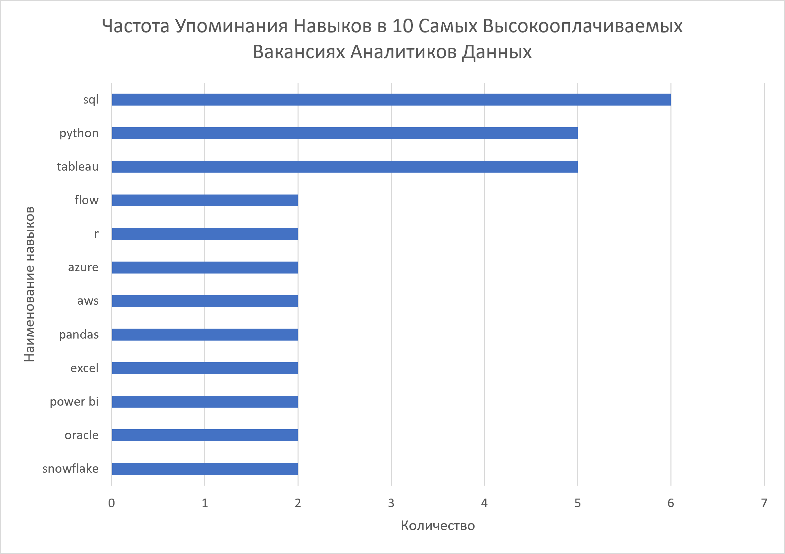
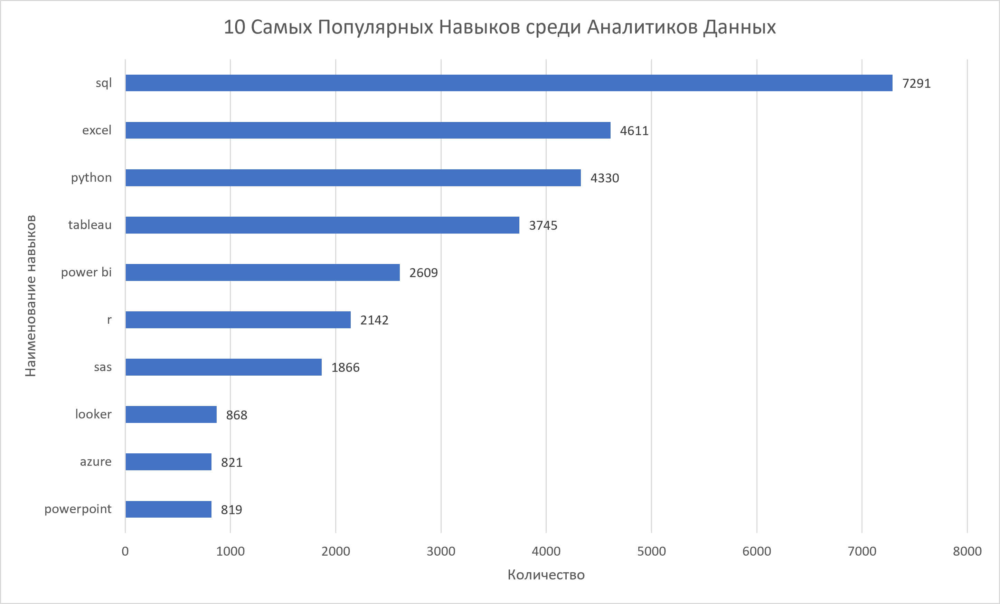
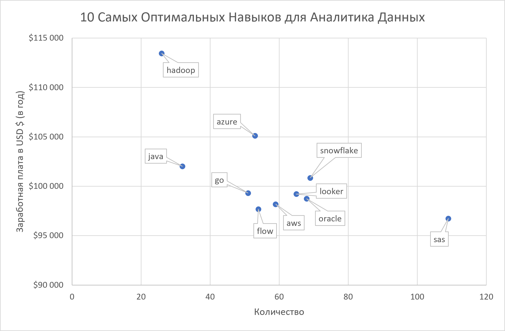

# Введение
В этом проекте будет изучен рынок вакансий аналитиков данных. Фокус будет на поиске:
- Самой высокой заработной платы;
- Самых востребованных навыков;
- И пересечении востребываемых навыков и высокой заработной платы.

В разделе [Основной Анализ](#основной-анализ) будут ответы на все 5 [вопросов](#вопросы) для вакансии Аналитик данных на удаленной работе. Все SQL запросы будут написаны в соответствующих вопросах и их можно будет посмотреть в папках Query_1, Query_2 и т.д.

[Дополнительная Работа](#дополнительная-работа) также будут ответы на вопросы, но там будут другие вакансии и страны. Данный раздел больше будет сделан для тренировки навыков в SQL, Excel и анализе полученных результатов. Все SQL запросы можно будет найти в папке [Additional_work](Additional_work)

Источник базы данных [Hugging Face/Luke Barousse](https://huggingface.co/datasets/lukebarousse/data_jobs)

# Вопросы

1. Какая наивысшая заработная плата у аналитиков данных работающих удаленно?
2. Какие навыки необходимы для работы аналитиком данных удалённо для получения наибольшой заработной платы?
3. Какие 5 самых востребованных навыков для аналитика данных на удалённой работе?
4. Какие 10 навыков для аналитика данных работающего удаленно приносят наибольшую заработную плату?
5. Какие 25 навыков являются самыми оптимальными для аналитика данных на удалённой работе?

# Инструменты

- MySQL - база данных
- Visual Studio Code - инструмент для программирования
- Excel - визуализация данных

# Основной Анализ

### 1. 10 Самых Высокооплачиваемых Вакансий Среди Аналитиков Данных

Для получения ответа на этот вопрос выведим столбцы ID, наименование компании, полное наименование вакансии, тип графика работы и заработную плату.
Отфильтруем данные оставив только вакансии 'Data Analyst', типом работы из дома и где указана заработная плата. Отсортируем полученые данные по заработной плате по убыванию и оставим только 10 верхних значений.

Код SQL:

``` sql
SELECT 
    job_id,
    job_title,
    company_dim.name AS company_name,
    job_schedule_type,
    salary_year
FROM project
LEFT JOIN company_dim ON project.company_id = company_dim.company_id
WHERE job_title_short = 'Data Analyst' AND location LIKE 'Remote' AND salary_year IS NOT NULL
ORDER BY salary_year DESC
LIMIT 10;
```


*10 самых оплачиваемых вакансий среди аналитиков данных (сделано в Excel)*

Благодаря этому запросу мы можем выяснить какие компании предоставляют наивысшую зарплату для вакансии Data Analyst при работе удаленно.

Выводы:
1) Заметен высокий разброс в заработной плате (от 650 тыс. до 189 тыс. долларов в год)
2) Разнообразие компаний предоставляющих вакансии, ИТ (Meta), здравохранение (Mantys, Uclahealthcareers), анализ финансов (SmartAsset) и т.д.
3) Разнообразные наименования вакансий отражающие разные роли и специализации между аналитиками данных.

### 2. Необходимые Навыки для 10 Самых Высокооплачиваемых Вакансий Аналитиков Данных

Теперь к результату полученному ранее добавлю навыки запрашиваемые к вакансиям.

Код SQL:

```sql
WITH top_paying_jobs AS (
    SELECT
            job_id,
            job_title_short,
            salary_year
        FROM project
        WHERE job_title_short = 'Data Analyst' AND location LIKE 'Remote' AND salary_year IS NOT NULL
        ORDER BY salary_year DESC
        LIMIT 10
)
SELECT
    top_paying_jobs.job_id,
    top_paying_jobs.job_title_short,
    top_paying_jobs.salary_year,
    skills_dim.skills
FROM top_paying_jobs
INNER JOIN skills_job_dim ON top_paying_jobs.job_id = skills_job_dim.job_id
INNER JOIN skills_dim ON skills_job_dim.skill_id = skills_dim.skill_id;
```



*Частота упоминания навыков в 10 самых оплачиваемых вакансиях аналитиков данных (сделано в Excel)*

На графике указаны навыки появляющиеся 2 и более раз.

Таблица со всеми навыками
|  skills  | count_skills |
|----------|--------------|
|sql       |   6          |
|python    |   5          |
|tableau   |   5          |
|flow      |   2          |
|r         |   2          |
|azure     |   2          |
|aws       |   2          |
|pandas    |   2          |
|excel     |   2          |
|power bi  |   2          |
|oracle    |   2          |
|snowflake |   2          |
|sheets    |   1          |
|databricks|   1          |
|pyspark   |   1          |
|jupyter   |   1          |
|powerpoint|   1          |
|hadoop    |   1          |
|crystal   |   1          |
|go        |   1          |
|numpy     |   1          |
|gitlab    |   1          |
|sap       |   1          |
|jenkins   |   1          |
|bitbucket |   1          |
|atlassian |   1          |
|jira      |   1          |
|confluence|   1          |

Выводы: Самыми популярными навыками являются SQL (появляется 6 раз), и второе и третье место занимают python и tableau (по 5 раз). Остальные навыки появляются не так часто по 2 или 1 разу, но всё ещё показывают спрос.


### 3. 10 Самых Популярных Навыков для Аналитика Данных

Теперь отфильтруем 10 самых популярных навыков необходимых для аналитика данных.

Код SQL:

```sql
SELECT
    skills,
    COUNT(skills_job_dim.job_id) AS demand_count
FROM project
LEFT JOIN skills_job_dim ON project.job_id = skills_job_dim.job_id
LEFT JOIN skills_dim ON skills_job_dim.skill_id = skills_dim.skill_id
WHERE job_title_short = 'Data Analyst' AND location = 'Remote'
GROUP BY skills
ORDER BY demand_count DESC
LIMIT 10;
```



*10 самых популярных навыков для аналитика данных (сделано в Excel)*

Вывод: С большим отрывом выделяется SQL, как никак это является базовым инструментом для анализа данных. Следующими выделяются excel, python и tableau. Excel является базовым навыком для аналитиков данных. Python обладает огромной библиотекой для анализа данных. Tableau используется для визуализации данных.


### 4. 10 Навыков Приносящих Наивысшую Заработную Плату для Аналитика Данных

В прошлом вопросе удалось найти навыки обладающими наивысшим спросом, теперь необходимо узнать какие навыки приносят наивысшую заработную плату.

Код SQL:

```sql
SELECT
    skills,
    COUNT(skills_job_dim.job_id) AS demand_count,
    ROUND(AVG(project.salary_year), 0) AS avg_salary_for_skill
FROM skills_dim
LEFT JOIN skills_job_dim ON skills_dim.skill_id = skills_job_dim.skill_id
LEFT JOIN project ON skills_job_dim.job_id = project.job_id
WHERE job_title_short = 'Data Analyst' AND location = 'Remote' AND project.salary_year IS NOT NULL
GROUP BY skills
ORDER BY avg_salary_for_skill DESC
LIMIT 10;
```


*10 самых оплачиваемых навыков для аналитика данных (сделано в Excel)*

Вывод: Навыки относятся к большому количеству разнообразных областей (большие данные, библиотеки python, облачные технологии, инструменты машинного обучения и т.д.). Но приэтом спрос на подобные навыки достаточно низок, данные навыки больше выделяются для высших специалистов аналитики данных.


### 5. Самые Оптимальные Навыки для Изучения на Аналитика Данных

Теперь когда мы знаем какие навыки имеют наивысшую заработную плату и наивысшим спросом, необходимо определить самые оптимальные навыки необходимые для аналитика данных.

Код SQL:

```sql
WITH demand_skills AS (
    SELECT
        skills_dim.skill_id,
        skills_dim.skills,
        COUNT(skills_job_dim.job_id) AS demand_count
    FROM project
    INNER JOIN skills_job_dim ON project.job_id = skills_job_dim.job_id
    INNER JOIN skills_dim ON skills_job_dim.skill_id = skills_dim.skill_id
    WHERE job_title_short = 'Data Analyst' AND location = 'Remote' AND project.salary_year IS NOT NULL
    GROUP BY skills_dim.skill_id, skills_dim.skills
), average_salary AS (
    SELECT
        skills_dim.skill_id,
        skills_dim.skills,
        ROUND(AVG(project.salary_year), 0) AS avg_salary_for_skill
    FROM skills_dim
    INNER  JOIN skills_job_dim ON skills_dim.skill_id = skills_job_dim.skill_id
    INNER  JOIN project ON skills_job_dim.job_id = project.job_id
    WHERE job_title_short = 'Data Analyst' AND location = 'Remote' AND project.salary_year IS NOT NULL
    GROUP BY skills_dim.skill_id, skills_dim.skills
)

SELECT
    skills_dim.skill_id,
    skills_dim.skills,
    demand_count,
    avg_salary_for_skill
FROM skills_dim
INNER  JOIN demand_skills ON skills_dim.skill_id = demand_skills.skill_id
INNER  JOIN average_salary ON skills_dim.skill_id = average_salary.skill_id
WHERE demand_count >= 25
ORDER BY avg_salary_for_skill DESC, demand_count DESC
LIMIT 25;
```



*10 самых оптимальнных навыков для аналитика данных (сделано в Excel)*

Таблица со всеми 25 навыками

|   skills   | demand_count | avg_salary_for_skill |
|------------|--------------|----------------------|
|hadoop      |   26         |    $113 449          |
|azure       |   53         |    $105 111          |
|java        |   32         |    $102 018          |
|snowflake   |   69         |    $100 841          |
|go          |   51         |    $99 309           |
|looker      |   65         |    $99 202           |
|oracle      |   68         |    $98 728           |
|aws         |   59         |    $98 165           |
|flow        |   54         |    $97 664           |
|sas         |   109        |    $96 734           |
|sas         |   109        |    $96 734           |
|python      |   388        |    $95 764           |
|r           |   237        |    $95 279           |
|jira        |   33         |    $94 560           |
|sql         |   701        |    $93 048           |
|tableau     |   404        |    $92 892           |
|spark       |   28         |    $92 191           |
|power bi    |   196        |    $92 156           |
|sheets      |   55         |    $91 046           |
|qlik        |   26         |    $90 062           |
|sharepoint  |   34         |    $89 651           |
|sql server  |   63         |    $87 448           |
|sap         |   38         |    $87 181           |
|vba         |   41         |    $86 971           |
|powerpoint  |   91         |    $86 116           |


Выводы:
1) Языки программирования Python и R выделяются достаточно высоким спросом (388 и 277 соответственно) и кроме этого навыки обладают ещё и высокой заработной платой (95 764 и 95 279).
2) Azure, snowflake и aws облачные технологии с достаточно высокими заработными платами (105 111, 100 841 и 98 165) и значительным спросом.
3) Технологии для визуализации данных tableau и looker так же показывают достаточно высокий спрос и среднюю заработную плату.
4) Технологии баз данных oracle, sql и sql server  показывают крайне высокий спрос и среднюю заработную плату.   


# Итоги

Из своего анализа я смог подвести следующие итоги:
1) Аналитикам данных на удаленной работе предлагается достаточно широкий диапазон заработных плат, самая высокая достигает 650 тыс долларов.
2) SQL является одним из самых востребованных навыков для получения наивысшей заработной платы.
3) SQL является самым востребованным навыком для аналитика данных что на начальных этапах, что на высоких.
4) Узнал об узконаправленных навыках которые могут принести более высокую заработную плату.
5) SQL является одним из самых оптимальных навыков для изучения так как повышает шансы на получении более выской заработной платы и спроса на рынке.

Данный проект позволил мне улучшить свои навыки в таких программах как SQL, python, excel и VS Code. Также я лучше стал понимать какие навыки необходимо изучать аналитику данных.      

# Дополнительная Работа

Больше практики с другими вводными для тренировки в использовании SQL и обучению анализу и подведении выводов из полученных результатов.

# English

## Intro


## Questions


## Tools


## Main Analysis


## Conclusion


## Additional Work
